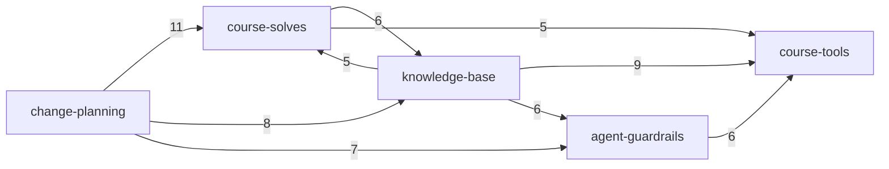

# Evidence: structure (mega-dev, head e22652b, 70 tracked files)

## Graph sources
- No language dependency graph exists: no manifest, no project graph tooling (level 1/2/3 all n/a). Languages: bash (tools/*, hooks/pre-commit), python (tools/transcribe.py, one file), node .mjs (4 files in .claude/skills/read/scripts, NOT listed in the scan contract; they import only node: builtins, evidence).
- Substitute: a reference map built by path-mention search (`rg`-style substring match of each tracked file's path in every other tracked file; script in session scratchpad). Output .work/edges-md.csv: 103 file-level edges, kind recorded as `runtime` only so graph-metrics runs. Level 4, confidence low.
- Edge meaning is MIXED and mostly prose: "file A names file B". Only 4 are executable (evidence, read from source): hooks/pre-commit -> .claude/skills/read/scripts/redact.mjs (CHECK var); tools/transcribe -> tools/transcribe.py (+ untracked tools/.venv, gitignored); .claude/skills/read/SKILL.md documents calls to its own scripts and to ~/.claude/skills/browser-automation (external, untracked). Instruction-level: .claude/agents/source-reader.md -> tools/transcribe; CLAUDE.md -> tools/*, templates.
- Blind: mentions by basename only, globs, paths built at runtime, prose that describes a file without its path, anything outside git (home-dir files, the owner's ~/repos/mega-hq, ~/.config/mega-hq). Working-tree-only files (tools/whereami, docs/environments.md, untracked) are named by tracked docs; excluded from the graph.
- Tool-to-tool edges: 0. Not one script in tools/ names another tracked file besides its own usage line (evidence, rg).

## Capability graph
graph-metrics (5 nodes, 18 inter-capability edges, mention graph). hq-card-queue has no edges at all in the graph (only 6 prose mentions of the directory `cards/`, no file inside it is referenced; cards/ holds one README).

| Capability | Ca | Ce | Instability |
|---|--:|--:|--:|
| agent-guardrails | 4 | 4 | 0.50 |
| knowledge-base | 4 | 4 | 0.50 |
| course-solves | 4 | 3 | 0.43 |
| course-tools | 4 | 3 | 0.43 |
| change-planning | 2 | 4 | 0.67 |

Edge counts (file-level mentions, from -> to): change-planning->course-solves 11, knowledge-base->course-tools 9, change-planning->knowledge-base 8, change-planning->agent-guardrails 7, agent-guardrails->course-tools 6, knowledge-base->agent-guardrails 6, course-solves->knowledge-base 6, course-solves->course-tools 5, knowledge-base->course-solves 5, change-planning->course-tools 3, knowledge-base->change-planning 3, others <=2. Intra-capability: course-solves 7, change-planning 7, course-tools 6, knowledge-base 4.

Inference: this is a documentation-reference web, not a layering. Do not read the instability numbers as code stability.

## Blast radius per capability
- course-solves (high): incoming mentions from change-planning (11), knowledge-base (5), course-tools (1: .claude/skills/read/SKILL.md names challenges/S01E02/log.md and page.html), agent-guardrails (2). Most-referenced files: challenges/S01E02/log.md and overnight.md (6 each). Outgoing: course-tools 5, knowledge-base 6. Contracts it exposes: HANDOFF-TEMPLATE.md and RETRO-TEMPLATE.md, named by CLAUDE.md and checked by tools/check-handoff and tools/retro-check (templates guarded by scripts: corridor, false-signal 3). Edge source on S01E01 is thin: 2 mentions of it (evidence).
- agent-guardrails (high): CLAUDE.md is named by 7 files and names 8 (tools/transcribe, check-handoff, retro-check, speech-offsets, both templates, playbook, source-reader). hooks/pre-commit has 4 mentions (archive note, environment.md, CHANGELOG, tool-ideas) and 1 executable edge: it calls .claude/skills/read/scripts/redact.mjs, so the secret-blocking guard depends on a script in the course-tools footprint (cross-capability, evidence). A rename or edit of redact.mjs silently changes what the hook blocks; it exits non-zero on tokens, but if the file is missing the hook's `node` call fails and blocks every commit (inference from source, not run).
- course-tools (medium): 4 callers by mention: knowledge-base (9: docs/tools.md, playbook, lessons), agent-guardrails (6), course-solves (5), change-planning (3). Most-named: tools/speech-offsets (6), tools/transcribe (5), tools/retro-check (4). External dependencies not in git: ffmpeg (speech-offsets), tools/.venv with the speech model (transcribe), ~/.claude/skills/browser-automation (read skill), node.
- knowledge-base (medium): docs/playbook.md (7 in) and docs/lessons-learned.md (6 in) are the most-referenced docs; docs/CHANGELOG.md has 16 outgoing mentions (a log, see mechanical).
- change-planning (low): outgoing only in practice (instability 0.67); 2 incoming.
- hq-card-queue (low): unknown graph position; cards/ referenced only by directory.

## Cycles
- Runtime (executable) cycles: none found; the 4 executable edges form no loop (evidence).
- Mention graph: one 5-node cycle covering every capability. Mechanical: prose cross-links among docs, not a runtime loop. Smallest real mutual reference: CLAUDE.md <-> docs/playbook.md (CLAUDE.md names playbook; playbook names tools); and course-solves/log.md <-> docs (docs cite S01E02 logs, logs cite lessons). Reported as mechanical.

## Broken boundaries
Intended layering (inference): foundation rules (agent-guardrails) -> tools -> course-solves/knowledge-base -> change-planning. Edges against it:
- agent-guardrails (hook) -> course-tools script (redact.mjs): the guard lives under .claude/skills/read, so the safety net depends on a skill folder. Real, executable.
- course-tools (.claude/skills/read/SKILL.md) -> challenges/S01E02/*: a generic skill has a hard-coded challenge path in its examples (prose; lines 62-73). Reuse for another challenge needs edits.
- tools -> docs/challenges: 0 (tools are self-contained, good).
- change-planning -> everything (about 29 outgoing mentions): plans reference all capabilities; low weight (rule 8).
Not measurable: anything inside challenges/S01E01 files beyond path mentions.

## Test risks
- No test suite tracked (no tests dir, no CI file in tracked files; evidence from ls-files). redact.mjs, cut-diff.mjs, find-contract.mjs use `node:assert` self-tests (imports `assert`); redact.mjs is explicitly self-tested (hook comment says it holds sample tokens for its self-test). Whether those self-tests run is unknown.
- Hard-to-test in isolation: tools/transcribe (needs untracked .venv and model download), tools/speech-offsets (ffmpeg), tools/spike-headless-mega-start (course server, session). pre-commit hook needs git state + node. check-handoff / retro-check are pure text validators: easiest to test with fixture markdown.
- Course answers are verified by the course server, so e2e = real challenge run; no local mock.

## Centres and thin entry points
- Load-bearing contracts (high Ca, low change surface): CLAUDE.md, HANDOFF-TEMPLATE.md/RETRO-TEMPLATE.md (+ their checkers), hooks/pre-commit + redact.mjs, docs/playbook.md.
- Thin entry points: tools/transcribe (a 8-line wrapper that execs transcribe.py), tools/speech-offsets (wrapper around ffmpeg). The core is transcribe.py and ffmpeg, not the wrappers.
- Fan-in from docs/CHANGELOG.md (16 out) and docs/tools.md is a log/index: rule 2/8, mechanical.

## Mechanical signals
- 103 edges total; at most 4 executable, the rest prose mentions (rule 8). docs/CHANGELOG.md alone emits 16 edges; context/changes/hq-solve-notes-and-schedules/plan.md 11; both planning/log, not ranked.
- No type-only or dist/build edges (n/a). Intra-capability edges (25 of 103) excluded from the cross-capability table.
- Edges from change-planning (29 cross-capability) are discussion about capabilities, not code reach.
- tools/whereami and docs/environments.md are untracked yet referenced by CLAUDE.md, docs/tools.md, CHANGELOG (modified, uncommitted per gitStatus); the HEAD graph does not contain them, so the map may show a dangling reference if CLAUDE.md edits are committed without them.

## Unknowns
- Whether core.hooksPath=hooks is set on every clone (it is set locally: `git config core.hooksPath` = hooks); an unset path means the secret guard does not run.
- Cross-repo coupling: ~/repos/mega-hq/ingest/solve-notes.mjs and ingest.mjs (named in CLAUDE.md, docs/tools.md); plan.md refers to mega-hq/worker.env. External, unknown consumers/producers (rule 10).
- Runtime coupling invisible to a graph: the course MCP server (mega-challenge), the owner env vars, ~/.config/mega-hq, ~/.claude/skills/browser-automation, agent-spawned subagents (source-reader), prompts that tell agents to read handoff.md.
- Mention matching can miss basename-only references (e.g. "retro-check" without path); counts are lower bounds.
- The .mjs language is outside the scan contract's language list (contract names bash, python, markdown); worth adding.
- Tool worth installing: none needed; a markdown link checker (lychee) would give a real link graph for docs. Not installed, not run.

## Commands run
- `git ls-files` (70); `awk|uniq` directory counts; python substring-reference script over tracked files -> .work/edges-md.csv; `node scripts/graph-metrics.mjs .work/edges-md.csv --modules .work/capabilities.tsv --kind runtime`; `rg` for imports, `cards/`, `~/repos`, tool usage lines; `git config core.hooksPath`; `git check-ignore`; `head hooks/pre-commit`.
