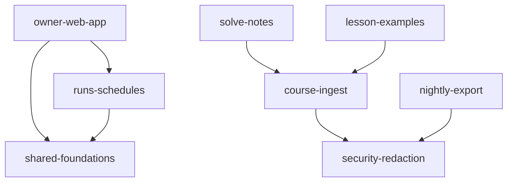

# Evidence: structure (mega-hq @ a0f0bfd, files from `git ls-files` incl. index; untracked web/src/lib/progress.ts added by hand)

## Graph sources
| Language | Source | Level | Confidence | Blind spots |
|---|---|---|---|---|
| TS/TSX/Astro (web/) | TypeScript compiler API from web/node_modules (installed project dep, not installed by me) used for import/export parsing; .astro frontmatter only; relative specifiers resolved to tracked files by my script (scratchpad ex.cjs). tsconfig has no path aliases. | 2 (own parser, not tsc program resolution) | medium | .astro template-body imports; CSS imports; no dynamic import() found (0); Astro file-based routing (pages -> URL) invisible |
| Node .mjs (ingest, export, shared, web/scripts, web/dev) | same script | 2 | medium-high | `readFileSync(new URL(...))` file couplings are not imports; subprocess/CLI spawns |
| Deno TS (supabase/functions/mcp) | same script (relative imports only) | 2 | medium | `jsr:` and `npm:@supabase/supabase-js` URL specifiers counted as external, not followed; `Deno.readTextFile(contract.json)` coupling invisible; `deno info` not run |
| SQL (migrations, pgTAP) | none | - | unknown | no graph: table/function cross-references, RLS, RPC names called from web/MCP are UNKNOWN |
No dependency-cruiser/madge/skott present; no repo-owned graph config. Folded with skill's scripts/graph-metrics.mjs (works, no install). Edge files: .work/edges-ts.csv, edges-mjs.csv, edges-all.csv (tests excluded; all-*.csv incl. tests).
Counts (evidence): 136 JS/TS/Astro files; non-test edges ts 163 runtime + 17 type; mjs 13 runtime; 87 test-file edges excluded; 3 unresolved relative specs (global.css; ../lib/progress x2 = untracked file); 0 dynamic imports.

## Capability graph
Runtime, folded by capabilities.tsv, 0 unmapped files. Excluding web/astro.config.mjs (build config, see Mechanical):
| Capability | Ca | Ce | Instability |
|---|--:|--:|--:|
| shared-foundations | 2 | 0 | 0 |
| security-redaction | 2 | 0 | 0 |
| course-ingest | 2 | 1 | 0.33 |
| runs-schedules | 1 | 1 | 0.5 |
| owner-web-app | 0 | 2 | 1 |
| solve-notes, lesson-examples, nightly-export | 0 | 1 | 1 |
| agent-intake-mcp | 0 | 0 | - (no cross-capability edge) |

Note: the repo-wide mapping sends web/src/*.ts, layouts/, astro.config to shared-foundations (prefix `web`).

## Blast radius per capability
- agent-intake-mcp (high): incoming 0 and outgoing 0 in the graph. Internally: index.ts -> auth, rpc, supabase_db; rpc -> tools -> rules -> redact.ts; db.ts is a type-only interface (5 importers). Evidence: no in-repo importer of it. Couplings outside the graph (unknown): contract.json read by contract_test.ts; redact.ts is a hand-kept TS port of shared/redact.mjs (guarded by shared/redact-parity.test.mjs, regex-line parity); SQL schema/RPCs it calls; external MCP agent clients (unknown external).
- owner-web-app (high): incoming 0 (entry layer); outgoing -> shared-foundations and runs-schedules (Runs.tsx). Pages: 8 .astro pages all import screens/pages.tsx, which imports the screens (evidence). Web data layer web/src/lib/data/* all go through lib/db.ts (9 importers) and lib/schemas.ts (zod, 17 importers, highest fan-in in repo).
- security-redaction (high): shared/redact.mjs importers: ingest/ingest.mjs and export/export.mjs (2 in-repo), plus Deno port by copy. A pattern change reaches ingest, solve-notes, lesson-examples (via ingest), nightly-export, and must be mirrored in supabase/functions/mcp/redact.ts. RLS/hardening migrations: UNKNOWN reach (SQL).
- platform-deploy (high): no JS import edges at all; reach unknown (Docker/nginx/systemd/Makefile/validate.sh, not graphed). scripts/validate.sh and Makefile reference shared/ and tests (rg hit), evidence of build wiring only.
- shared-foundations (medium): lib/schemas.ts 17, lib/hq.tsx 10, ui/ScreenFrame 9, lib/season 9, lib/db.ts 9, ui/QueryStates 8, ui/Header 8, lib/useQuery 8 runtime importers. Load-bearing contracts, instability 0.

## Cycles
- Runtime, capability level: 1 reported owner-web-app <-> shared-foundations; real cause is a single edge web/astro.config.mjs -> web/scripts/{check-env,externalize-inline}.mjs (config/build wiring, mapped to `web` = shared-foundations). Mechanical, not architecture. Without it: 0 cycles.
- File level, runtime (excluding astro.config): 0 cycles. Type-only loop exists: web/src/lib/hq.tsx <-> hq.types.ts (type edges only, 2 files; mechanical).

## Broken boundaries (inference of intended layering: ui/lib -> data -> screens -> pages)
- No upward import from lib/ui/test into screens/pages (0 edges, evidence). Layering is clean in web.
- Runs.tsx (runs-schedules) sits in owner app screens but is its own capability; it imports lib/ and ui/ only. Fine.
- Inference: mcp function duplicates, rather than imports, shared/redact.mjs (Deno edge deploy cannot import repo-root). Drift guarded by a parity test (rule 3: guarded lockstep, corridor not hidden contract, but guard compares regex lines only).
- ingest/solve-notes.mjs -> ingest/ingest.mjs: solve-notes and lesson-examples both depend on course-ingest internals (ingest.mjs 2 importers + map.mjs 3). Inference: intended, same module family.

## Test risks
- agent-intake-mcp: good isolation: db.ts is an interface, supabase_db.ts the only client importer; tests use fakes (Deno tests). Real RLS/RPC behaviour only in pgTAP.
- web screens: Today/Task/Episode/Sessions fan-out 12-16 files each (hq.tsx context, useQuery, data layer, ui); tests need a fake db (web/src/test/fakeDb.ts, fixtures) i.e. provider-style mocking; ~87 test-file edges show this is done.
- ingest/export: pull supabase network and owner login at the CLI; maps (map.mjs etc.) are pure and separable; I/O at ingest.mjs/export.mjs.
- SQL: nothing in graph; pgTAP files 01-08 are the only isolation.

## Centres and thin entry points
- Centres: web/src/lib/schemas.ts (zod schemas, fan-in by design = config-as-code rule 2; compile/zod parse catches breaks), lib/db.ts, lib/hq.tsx.
- Thin entries: web/src/pages/*.astro (8) each only delegate to screens/pages.tsx; supabase/functions/mcp/index.ts delegates to auth/rpc/supabase_db; ingest/export CLIs are entry candidates (examples.mjs, solve-notes.mjs).
- Fan-out leaders (screens): Task 16, Today 15, Episode 13, Sessions 12, Runs 11, Course 11.

## Mechanical signals
- Type-only edges: 17 (ts), 0 (mjs). Largest: Deno db.ts interface (5) and lib/db.ts.
- Build/config: astro.config.mjs -> web/scripts (2 edges) causes the only cycle. No dist/ edges.
- Fan-in on schemas.ts/ScreenFrame etc. is design (rule 2).
- Working tree: runs-schedules code is staged (Runs.tsx, data/runs.ts, schedules.ts, runs.astro) and progress.ts + a fix_set_paused migration are untracked; graph includes index files and hand-added progress.ts edges, so it describes the uncommitted state of web/ (a0f0bfd HEAD alone would lack them).

## Unknowns
- SQL graph (functions, tables, RLS, RPC names used by web/MCP/ingest): none built; SQL cross-capability reach unknown. Biggest blind spot given security-redaction and agent-intake are SQL-heavy.
- Deno URL imports (jsr:, npm:) not followed; version pins only partly checked.
- Runtime coupling: PostgREST/RPC calls by string name, Astro file routing, service worker (web/public/sw.js), env vars, systemd timer, nginx; external MCP clients of contract.json.
- Tool worth installing: dependency-cruiser (TS/Astro path and orphan rules) or madge; `deno info --json` for the Deno graph; a SQL dependency extractor (e.g. pg_depend on a local DB).

## Commands run
git ls-files; node ex.cjs (scratchpad, TypeScript compiler API parse); node graph-metrics.mjs edges-all.csv --modules capabilities.tsv --kind runtime [--exclude astro.config] [--emit mermaid]; rg/awk/grep on edge CSVs and files; git status --short.
