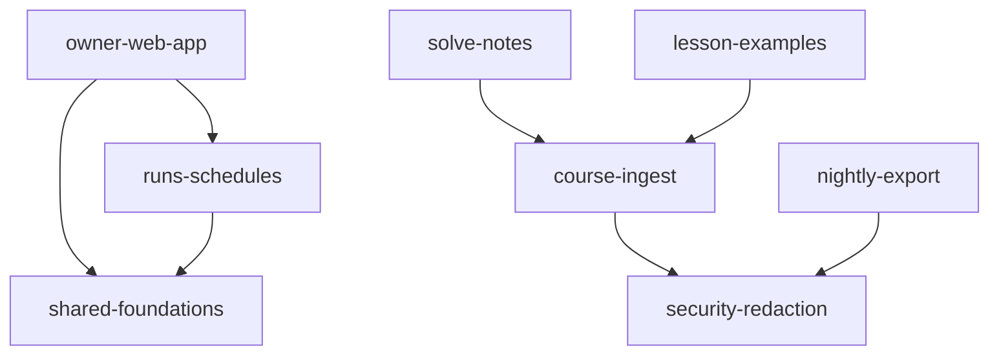

# mega-hq: project map

## TL;DR
mega-hq is the owner's private phone app for the MEGA.dev course: AI agents propose "cards" over an MCP endpoint, the owner approves them in an Astro/React web app, and course data (challenges, lessons, solve notes, example links) is loaded by Node scripts into a Supabase database. It runs on the UGREEN host in Docker (web on `127.0.0.1:18780`, Supabase on 54421-54424), with a nightly card export. Most change sits in the web app and its shared UI/data kit (shared-foundations 128 file-changes, owner-web-app 104); the security-critical pieces (MCP intake, redaction, SQL hardening) were built in the first hour and rarely touched since. All 100 commits come from one AI-session identity and the 3 PRs were self-merged with no human review. No capability meets the risk-zone bar; the watch list is the hand-kept pairs and a few second-attempt spots. Work in the checkout is not all committed: the Runs and schedules feature is staged by another session.

Runtime import edges between capabilities (agent-intake-mcp has none in the graph; platform-deploy is not graphed). It describes web/ as staged, not HEAD alone.

## Terrain
| Capability | What it does | Criticality (criteria) | Change (file-changes / commits) | Fix pressure | Friction / attention | Reach | Lives in |
|---|---|---|---|---|---|---|---|
| agent-intake-mcp | agents propose cards and read challenges/lessons over MCP, per-agent tokens | high (public endpoint, token auth, writes) | 44 / 13 | 15%, hardening (mechanical) | hardening passes, no breakage seen | no in-repo edges; hidden: `contract.json` lockstep, hand-kept `redact.ts` port, SQL RPCs | `supabase/functions/mcp/`, `contract.json` |
| owner-web-app | owner screens: Today, Task, Episode, Sessions, Settings, Approve, Course | high (owner login, approves cards, core value) | 104 / 33 | 30%, same-day UI iteration (mechanical) | 35-minute fix burst on the data layer (iteration) | entry layer: Ca 0, Ce 2 | `web/src/screens/`, `web/src/pages/`, `web/e2e/` |
| security-redaction | secret redaction, RLS and hardening migrations | high (identity, access, secrets) | 10 / 5 | 40% of 5, mechanical hardening | PR #3 secret screen | `shared/redact.mjs` reaches ingest, export, solve-notes, lesson-examples; must be mirrored by hand in Deno | `shared/`, security and hardening migrations |
| platform-deploy | Docker, compose, nginx, smoke tests, runbooks, Makefile | high (can take the app down) | 45 / 18 | 33%, trial-and-error deploy (mechanical) | 4 deploy fixes in 20 min after the smoke test landed; the repo's only 2 TODO/FIXME | unknown (no import graph) | `deploy/`, `scripts/`, `runbooks/`, `Makefile` |
| shared-foundations | UI kit, zod schemas, data layer, test fakes | medium (everything in web depends on it) | 128 / 36 | 33%, mechanical | none separate from owner-web-app | load-bearing: `schemas.ts` 17 importers, `hq.tsx` 10, `db.ts` 9 (config-as-code, mechanical) | `web/src/ui`, `lib`, `styles`, `test` |
| course-ingest | load challenges and lessons into HQ | medium (writes with owner login) | 19 / 7 | 29% | invisible-character sanitising re-fixed 3 times in 25 minutes | Ca 2 (solve-notes, lesson-examples) | `ingest/` |
| lesson-examples | sync lesson example links | low | 18 / 10 | 30% | same sanitising loop | depends on course-ingest | `ingest/examples*`, migration, test 06 |
| solve-notes | summary and snag table per solved challenge | medium (user data written) | 6 / 1 | n/a | new on day 2 | depends on course-ingest | `ingest/solve-notes*`, migration, test 07 |
| nightly-export | systemd timer exports cards | low | 21 / 9 | 33% | none | depends on redaction | `export/`, `deploy/systemd/` |
| runs-schedules | runs table, pause switch, Runs screen | medium (future worker control) | 0 commits at HEAD, staged by another session | unknown | planned via issues #4-#7 and #9 | between web and foundations | staged files only |
| docs-planning | specs, plans, ADR | low | 19 commits, prose | n/a | 5 plans, 2 specs, 1 ADR, 4 runbooks | none | `docs/`, `adr/` |

Coverage: 1% of changes unmapped (4 files: `.dockerignore`, `package.json`, `.gitignore`). Capability inventory is an inference from commit scopes, route names and table/migration names. Trends are build phases (backend, then web, then deploy, then examples, then day 2), not trends.

## Real couplings
- **`contract.json` ↔ `supabase/functions/mcp/tools.ts`**: lockstep, guarded by `contract_test.ts`. Guarded, mechanical.
- **`shared/redact.mjs` ↔ `supabase/functions/mcp/redact.ts`**: a hand-kept copy (the Deno function cannot import repo-root files). Guarded only by `shared/redact-parity.test.mjs`, which compares regex lines. Co-change not provable from history. Real, hand-kept.
- **`web/src/lib/schemas.ts` ↔ SQL migrations**: web zod schemas mirror table shapes by hand (inference, not tested for drift). Hand-kept, unknown guard.
- **`ingest/solve-notes.mjs` and `examples.mjs` → `ingest/ingest.mjs`**: same module family, intended (runtime import).
- **`owner-web-app` ↔ `shared-foundations`**: 21 co-changed commits (confidence 0.64): one app split by directory. The single reported cycle comes from one edge, `web/astro.config.mjs` → `web/scripts/*`: build wiring, mechanical.
- **SQL, RLS and RPC names called by web, MCP and ingest**: unknown. No graph exists, and it is the largest blind spot because intake and security are SQL-heavy.
- **External (unknown)**: MCP clients of `contract.json` (agents, Grok bot), the UGREEN Docker/systemd environment, `~/.config/mega-hq` secrets, the course MCP.

## Risk zones
None qualify. Every high-criticality capability has buzz in only one independent family, and most of that is mechanical.

**Watch**
- **security-redaction + agent-intake-mcp**: the hand-kept redaction twin (`shared/redact.mjs` vs `supabase/functions/mcp/redact.ts`). Criticality high; reach is the widest in the repo (four consumers plus the Deno copy); the guard compares regex lines only. Files: `shared/redact.mjs`, `shared/redact-parity.test.mjs`, `supabase/functions/mcp/redact.ts`, `supabase/functions/mcp/rules.ts`.
- **course-ingest (+ lesson-examples)**: the clearest second-attempt pattern (sanitising fixed 3 times in 25 minutes). Criticality medium. Files: `ingest/ingest.mjs`, `ingest/examples.mjs`.
- **runs-schedules**: planned as the worker-control feature, but 0 commits at HEAD and staged by another session; any claim about it is unknown until committed. Files: staged `web/src/screens/Runs.tsx`, `supabase/migrations/20261029120000_runs_schedules.sql`, `supabase/tests/database/08_runs_schedules.test.sql`.
- **platform-deploy**: highest blast radius by criticality, but reach is unmeasurable here (no graph) and the fixes read as deploy iteration. Files: `deploy/web/deploy.sh`, `scripts/validate.sh`, `runbooks/hq-web-deploy.md`.

**Looks hot, is not**
- `shared-foundations` and `owner-web-app` have the most commits and 30-33% fix share: one app, same-day hardening of fresh code, no reverts (false-signal rules 4, 5).
- `web/src/lib/schemas.ts` fan-in of 17 is config-as-code by design.
- Every PR touches more than 3 capabilities and merged within about a minute: PR counts say nothing about a capability.
- The one capability-level cycle is a build-config edge.

## Whom to ask
- Git cannot answer. All 100 commits are one shared identity ("Mother Console") and carry Claude co-author trailers (89 Sonnet 5.5 and 12 Haiku 5.5 by trailer line count; the sum is 101, unresolved). The owner (GitHub `titusandronicu`) authored 3 merge commits (PRs #1, #2, #3 per the people evidence). Human review: none; sourcery and codex bot comments only.
- Use the specs, plans, ADR and runbooks as the memory: `docs/superpowers/specs/2026-10-26-mega-hq-design.md`, `docs/superpowers/plans/`, `adr/0001-mega-hq.md`, `runbooks/`.
- Open issues: 6, none bug-labelled, no comments.

## First day
1. `README.md`: commands (`make validate`, `make smoke`, `npm test`), links to specs and runbooks.
2. `docs/superpowers/specs/2026-10-26-mega-hq-design.md` and `adr/0001-mega-hq.md`: why it is built this way.
3. `contract.json`, then `supabase/functions/mcp/index.ts` → `tools.ts` → `rules.ts`: the agent API and where logic lives.
4. `shared/redact.mjs` and `supabase/functions/mcp/redact.ts`, with `shared/redact-parity.test.mjs`: the secrets guard and its twin.
5. `supabase/migrations/20261026100000_schema.sql`, then the rest in order: the data model.
6. `web/src/screens/pages.tsx` and `web/src/lib/hq.tsx`, `lib/db.ts`, `lib/schemas.ts`: the web entry and its load-bearing core; then `screens/Task.tsx` and `Today.tsx` (highest fan-out, 16 and 15).
7. `ingest/ingest.mjs` and `ingest/solve-notes.mjs`: how course data gets in.
8. `scripts/validate.sh`, `Makefile`, `runbooks/hq-deploy.md`, `runbooks/hq-web-deploy.md`, `deploy/web/deploy.sh`: the local gate and deploy path (there is no CI).
Not at HEAD (staged): `web/src/screens/Runs.tsx`.

## Limitations
- Window: about 8 hours of build, 98 of 100 commits on day 1. Instability of anything cannot be judged. One identity, so no ownership or bus factor.
- Sources: git and the forge (3 PRs, 6 open issues). Bot review contents and issue bodies not read.
- Graph: TS/TSX/Astro and Node medium; Deno relative imports only (`jsr:` and `npm:` not followed); SQL none; `.astro` template-body imports not covered. The graph includes staged index files and a hand-added untracked `web/src/lib/progress.ts`, so it describes web/ as staged, not HEAD alone.
- Capability coverage: 1% unmapped. runs-schedules has no history, so it is invisible in change and co-change.
- Unknown: SQL, RLS and RPC coupling; Astro routing and the service worker; hand-kept pairs `schemas.ts` ↔ migrations, `stub-api.mjs` ↔ the real API, `contract.json` ↔ the Settings screen; production errors (no tracker seen); where bugs are tracked; Node 22 behaviour (host runs Node 26).
- Tools worth installing for a deeper pass: dependency-cruiser or madge, `deno info --json`, a SQL dependency extractor (e.g. `pg_depend` on a local DB).
- Companion: `context/foundation/health-check-mega-hq.md` (dependencies, tests, CI, config).
