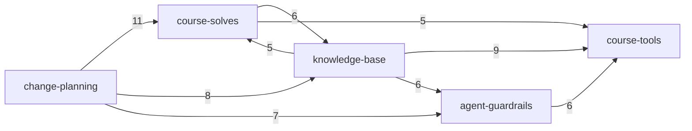

# mega-dev: project map

## TL;DR
mega-dev is the owner's work area for the MEGA.dev course: one folder per challenge (log, debrief, handoff, retro), a small toolbox (transcribe, speech-offsets, handoff and retro checkers, a secrets-redaction hook), a lessons/playbook knowledge base, and plans for the HQ app that lives in a separate repo (`~/repos/mega-hq`). It holds prose and shell, no application code. All 26 commits come from one shared AI-session identity; the owner's GitHub account only merges PRs (#1, #3, #4) with no human review. Most activity is documentation and planning (knowledge-base 19 commits, change-planning 15, course-solves 14), driven by the HQ initiative and the S01E02 challenge. No capability meets the risk-zone bar; two are on the watch list (below).

Edges are "file A names file B" counts from the structure evidence (documentation references, not code calls).

## Terrain
| Capability | What it does | Criticality (criteria) | Change (commits) | Fix pressure | Friction | Reach | Lives in |
|---|---|---|---|---|---|---|---|
| course-solves | per-challenge log, debrief, handoff, retro, templates | high (core value; submits answers to the course server) | medium (14) | none seen (0 fix commits) | medium: S01E02 transcription blocker, 3 attempts (inference) | high in docs (11 mentions from planning) | `challenges/` |
| agent-guardrails | rules and safety nets for agents | high (blocks secrets; identity and access rules) | low (9) | none | none | high: pre-commit hook runs `redact.mjs` (the only cross-capability executable edge) | `CLAUDE.md`, `hooks/`, `context/foundation/` |
| course-tools | transcribe, speech-offsets, checkers, read skill, source-reader | medium (feeds correct answers) | low (5) | none | none | medium: 4 callers by mention; tools do not call each other | `tools/`, `.claude/` |
| knowledge-base | lessons, playbook, tool notes, changelog | medium (steers future sessions) | high (19), mostly prose churn | none | none | medium: playbook and lessons are the hubs | `docs/` |
| change-planning | plans, research, archive for in-flight changes | low | high (15), new HQ initiative | n/a | n/a | outgoing only | `context/changes/`, `context/archive/` |
| hq-card-queue | deck cards bound for HQ | low | 1 | n/a | 1 TODO, the only debt marker in the repo | none | `cards/` (one README) |

Coverage: 0% unmapped. Catch-all buckets are not used. History is about 2 days with one identity, so every "trend" is a short-run observation.
Where folders and capabilities disagree: `.claude/` holds both the generic `read` skill (a course tool) and the source-reader agent; `context/foundation/` is guardrail material that sits next to planning folders; `docs/` mixes lessons (knowledge) with `tools.md` (a tool index).

## Real couplings
- **Pre-commit hook → `redact.mjs`** (agent-guardrails → course-tools). Executable, from source. If `redact.mjs` is missing the hook's `node` call fails and blocks every commit (inferred, not run). `core.hooksPath=hooks` is a local git setting, so an unset path means the secret guard does not run on another clone.
- **Templates and their checkers**: `HANDOFF-TEMPLATE.md` ↔ `tools/check-handoff` and `RETRO-TEMPLATE.md` ↔ `tools/retro-check`, named by `CLAUDE.md`. A guarded corridor, mechanical.
- **Docs-in-the-same-commit rule**: `change-planning` ↔ `knowledge-base` co-change (8 commits, confidence 0.53) and `course-solves` ↔ `knowledge-base` (6, 0.43). Cause: the `CLAUDE.md` rule "update docs/ in the same commit". A convention, not a code link.
- **Mention cycle** across all five capabilities: prose cross-links, not a runtime loop. Mechanical.
- **External, invisible to the graph (unknown)**: the course MCP `mega-challenge`, `~/repos/mega-hq/ingest/solve-notes.mjs`, owner env vars in `~/.config/mega-hq`, `ffmpeg`, `tools/.venv`, `~/.claude/skills/browser-automation`.
- **Boundary leak**: the generic `read` skill's `SKILL.md` hard-codes `challenges/S01E02` paths in its examples (prose, mild).

## Risk zones
None qualify. No capability has high criticality and high buzz in two independent families.

**Watch**
- **course-solves** (criticality high). Change is medium, and the S01E02 transcription blocker shows second attempts (commits `8b89d2c`, `0ea50a3`, `8a21f63`, fixed by `7f2b3e9`). Both signals share one cause, the active S01E02 challenge, so they count once. Files: `challenges/S01E02/log.md`, `challenges/S01E02/overnight.md`.
- **agent-guardrails** (criticality high). Change is low and friction is zero, but its real reach is the largest executable dependency in the repo (hook → `redact.mjs`) and it depends on a per-clone local setting. Files: `hooks/pre-commit`, `.claude/skills/read/scripts/redact.mjs`, `CLAUDE.md`.

**Looks hot, is not**
- `knowledge-base` and `change-planning` have the most commits. That is prose and planning churn from one initiative, not instability (false-signal rules 4 and 8).
- `docs/CHANGELOG.md` is touched in nearly every commit and emits 16 outgoing mentions. It is a log.
- The five-node mention cycle is prose cross-linking.
- Fix pressure reads 0% only because the commit vocabulary has no fix words (weak evidence, not proof).

## Whom to ask
- Git cannot answer. One shared identity ("Mother Console", AI-session) authored all 26 commits and every commit carries a Claude co-author trailer, so concentration is a baseline and there is no bus-factor finding.
- The owner (GitHub `titusandronicu`) merges every PR. Whether they review content or only merge is unknown.
- For past decisions read: PRs #1, #3, #4; each challenge's `log.md` and `handoff.md`; and the plans in `context/changes/`.

## First day
1. `CLAUDE.md`: the rules every session follows (tools, handoff, retro, HQ ingest).
2. `docs/playbook.md`, then `docs/lessons-learned.md`: the two reference hubs.
3. `context/changes/README.md`: what is in flight; follow its table into the plans.
4. `challenges/S01E02/log.md`: the most active challenge and its history.
5. `challenges/HANDOFF-TEMPLATE.md` and `challenges/RETRO-TEMPLATE.md`, with `tools/check-handoff` and `tools/retro-check`: the contracts for starting and ending a challenge.
6. `hooks/pre-commit` and `.claude/skills/read/scripts/redact.mjs`: the secret guard.
7. `tools/transcribe` (wrapper) and `tools/transcribe.py` (the logic): local speech-to-text.
8. `docs/tools.md`: the tool index. Not yet at HEAD: `docs/environments.md` and `tools/whereami` (uncommitted, but `CLAUDE.md` edits already name them).

## Limitations
- Window: about 2 days, 26 non-merge commits, one identity. No trends, no ownership, no bus factor.
- Sources: git and the GitHub forge (3 PRs, 1 issue). PR discussion was not read; the 3 PRs each merged 1-46 seconds after opening with no human review. Bot comments exist, content unread.
- Graph: path-mention map only (confidence low); basename-only mentions are missed, so counts are lower bounds. Only about 4 of 103 edges are executable.
- Capability coverage: 0% unmapped. The inventory is an inference from commit scopes, directory names and the project's own docs.
- Dangling reference: uncommitted `CLAUDE.md` and `docs/tools.md` edits name `tools/whereami` and `docs/environments.md`, which are not at HEAD.
- Unknown: whether the `node:assert` self-tests in the `.mjs` scripts run (no tests or CI are tracked); whether `core.hooksPath` is set on other clones; whether any challenge answers were wrong or redone; whether `tools/` and `hooks/` drift from `docs/tools.md` and `CLAUDE.md` (no check found); `.mjs` is outside the scan contract's language list.
- Worth a focused look: the hook → `redact.mjs` dependency and the missing self-test run; a Markdown link checker (e.g. lychee) would give a real link graph for the docs (not installed).
